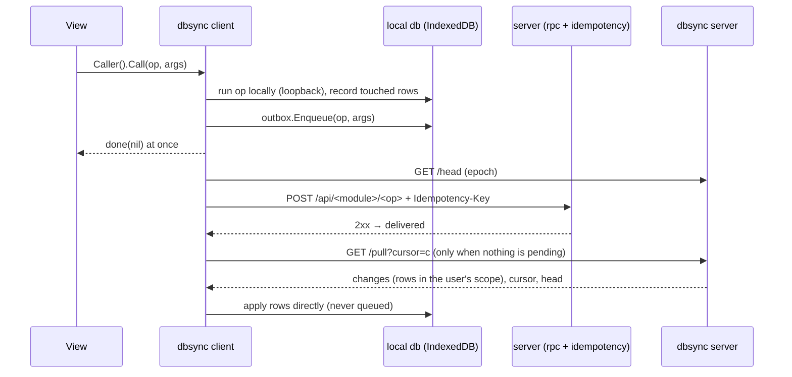
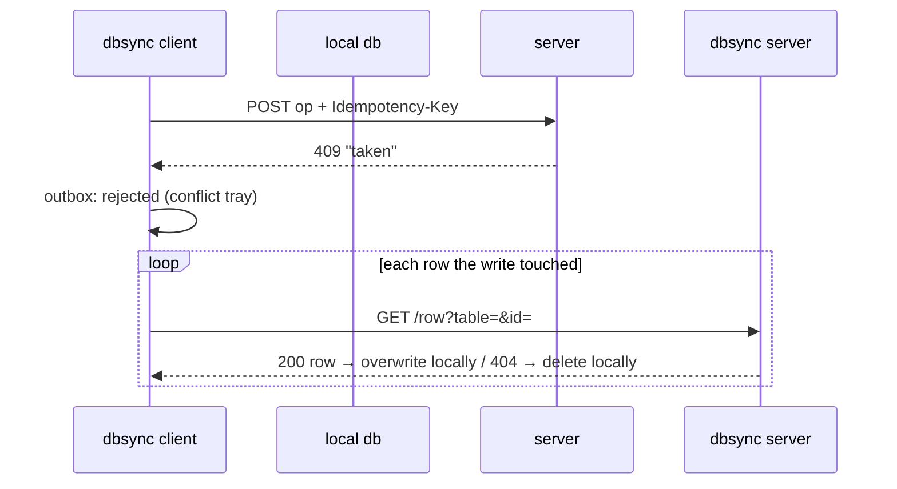

# dbsync — architecture

`dbsync` glues published pieces together and re-implements none of them:

| Piece | Role here |
|---|---|
| `router.OperationModule`, `router/loopback.ActingAs` | the same modules run in the browser, in process, with the user's identity |
| `webtyp.com/outbox` | ordered, durable queue of local writes; retry, reject, redeliver, prune |
| `rpc.Caller.CallKeyed` | sends one queued write to its normal endpoint `POST /api/<module>/<op>` with `Idempotency-Key: <mutation id>` |
| `webtyp.com/idempotency` | server middleware: a repeated key is answered once |
| `webtyp.com/changelog` | server: versioned record of every write (the feed). Browser: which rows a local write touched |
| `webtyp.com/unixid` | `<nanos>.<replica>` ids that never collide between devices |

## Write → queue → push → pull



## Reject → undo



## Decisions

- **Two views of the local database.** The offline modules write through a `changelog.Log` over
  the local connection, so dbsync knows exactly which rows a write touched; the local change log is
  emptied right after each write. Everything that comes from the server (first copy, pull, undo)
  is written directly, so it is never recorded or queued.
- **Pull only when nothing is pending.** The local view never has to replay pending writes on top
  of pulled rows; it converges once the queue is empty.
- **The cursor comes from the server.** `/pull` answers the version of the last change it read,
  kept or filtered out. The client stops when that cursor reaches `head`.
- **Epoch.** Each server process has one. A new epoch (restart, failover to a standby) makes the
  client resend what it delivered in the last 10 minutes; the idempotency store answers what the
  server already has.
- **Operations without `Requires` are not offline.** Only declared actions are classified: exactly
  `model.Read` = read; any other action = write.
- **Columns by user.** `Rule.Fields(userID)` narrows the columns a user receives (minimisation:
  a box keeps id, name and RUT of the directory; reception every column). Applied in `/snapshot`,
  `/pull` and `/row`; the device stores the other columns empty. An unknown column name answers 500.
- **Scopes are AND-only.** `orm` joins conditions flat, so `id = x OR owner = u` would return rows
  outside the user's scope; a condition built with `storage.Or` is refused (`/snapshot`, `/pull`
  and `/row` answer 500).

## Known limits

- The local write and its enqueue are not one transaction: a page closed between them keeps the
  local row without queueing it.
- `rpc.Caller` has no request timeout: a push to a server that never answers waits for the
  browser's own network timeout (dbsync's own requests time out after 10 s).
- `Since` keeps one entry per row: rows changed many times travel once, with their latest state.

## Showing it to the person

Every app exposes the engine's state in its header slot via the indicator component, and resolves rejected writes via the conflict tray:

```go
Status: func() Component { return ui.Indicator(client) }
```
